# azure-servicebus-console

[](https://github.com/zidad/azure-servicebus-console/actions/workflows/build.yml)
[](https://www.nuget.org/packages/Net.Azure.ServiceBusConsole)
[](https://www.nuget.org/packages/Net.Azure.ServiceBusConsole)
[](https://github.com/zidad/azure-servicebus-console/releases/latest)
[](https://dotnet.microsoft.com/download)
[](LICENSE)

A terminal UI browser for Azure Service Bus — explore namespaces, queues, topics, and messages directly from your terminal.

Built with [RazorConsole](https://github.com/RazorConsole/RazorConsole): Blazor Razor components rendered to the terminal via Spectre.Console.

## Install

Requires [.NET 10 SDK](https://dotnet.microsoft.com/download) and an active Azure CLI login.

```bash
dotnet tool install -g Net.Azure.ServiceBusConsole
az login
azsb
```

To update to the latest version:

```bash
dotnet tool update -g Net.Azure.ServiceBusConsole
```

## Command line

```bash
azsb --subscription "Contoso Development" --namespace sb-orders-dev   # straight to the namespace's queues
azsb -s 00000000-0000-0000-0000-000000000000                         # connection page, subscription selected
azsb -s emulator -n localhost                                        # the local emulator
azsb help                                                            # all flags
```

- `--subscription` / `-s`: Azure subscription by name or ID (case-insensitive); `emulator` or `Local Emulator` for the local emulator
- `--namespace` / `-n`: namespace in that subscription, by name or host name (`sb-orders-dev.servicebus.windows.net`); needs `--subscription`
- They apply at startup only: `Esc` back to the connection page works as usual. A subscription or namespace that isn't found is reported there
- `--theme` / `-t`: `dark` or `light` terminal background; `auto` (default) reads `COLORFGBG` where the terminal sets it, else dark. Colors are the terminal's 16 palette colors, so its color scheme sets their shade
- Without `--subscription`, the Azure CLI's current subscription (`az account set`) is preselected; the subscription list marks it `(az default)`
- Parsed by [JasperFx](https://github.com/JasperFx/jasperfx); `azsb help` also lists its generic host flags (`--config:<key> <value>`, `--environment`, `--log-level`)

## Features

- Lists the Azure subscriptions of your `az` login by name, hides the ones without Service Bus namespaces, and lets you filter them; the local emulator is always available
- Starts in the Azure CLI's current subscription, or in the subscription and namespace given on the [command line](#command-line)
- Namespace details (resource group, location, SKU, status) on the connection page
- Switch subscription, namespace or section (Queues, Topics, All Subscriptions) from dropdowns in the header
- Offers what the namespace supports: Basic tier namespaces have no topics, so their Topics and All Subscriptions sections are hidden; the local emulator can't delete entities, so its lists have no Delete
- Queues, topics and subscriptions with live message counts (active, DLQ, scheduled, transfer): everything loads from a local cache first, then polls every 15 seconds; changed counts flash briefly. When the live listing fails, the cached rows stay
- Sort any list by clicking a column header (ascending, descending, off); the default sort shows in the header (DLQ for queues and all subscriptions, name for a topic's subscriptions)
- Filter queues, topics, subscriptions and Azure subscriptions by typing
- Color-coded counts and states: dead letters in red, zero counts dimmed, lock and browse modes highlighted
- Peek, receive (PeekLock) or receive-and-delete a chosen number of messages, like the Azure portal's Service Bus Explorer
- Multi-select messages (`Space`, click the checkbox, `A` all, `I` invert) and act on all of them at once
- Locked messages: complete, abandon, dead-letter or requeue; locks renew automatically and are released when you leave
- Split message browser: the list on top, a preview of the message under the cursor below (properties left, JSON-highlighted body right); `Enter` opens it full screen
- Dead-letter queue browsing per queue and per subscription; requeue dead-lettered messages to their origin
- Delete queues, topics or subscriptions (Azure namespaces); purge (dead-letter) queues
- Metrics panel: Azure Monitor charts of throughput and backlog for the selected namespace, queue or topic, over 1 hour to 30 days; see [Metrics](#metrics)
- A namespace firewall that blocks your IP is explained in one line instead of a raw 401 response
- The connection page shows the cache's path and a button to clear it
- Mouse support: buttons, rows, column headers, header dropdowns, wheel scrolling

## Screenshots

*Sample data from the test suite; regenerate with `tools/update-screenshots.sh`.*

**Connection**: Azure subscriptions of your login, filter, namespace details, the selected namespace's metrics

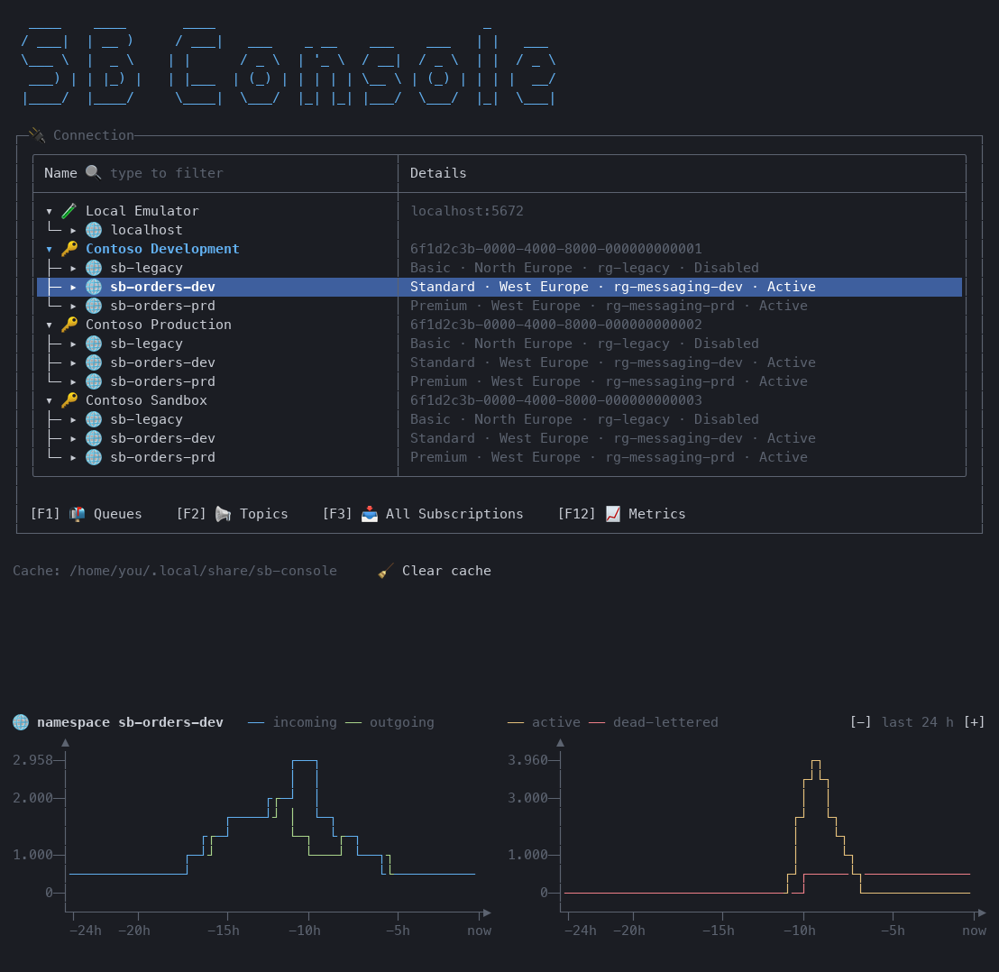

**Queues**: color-coded counts, sortable columns, type to filter, metrics of the selected queue

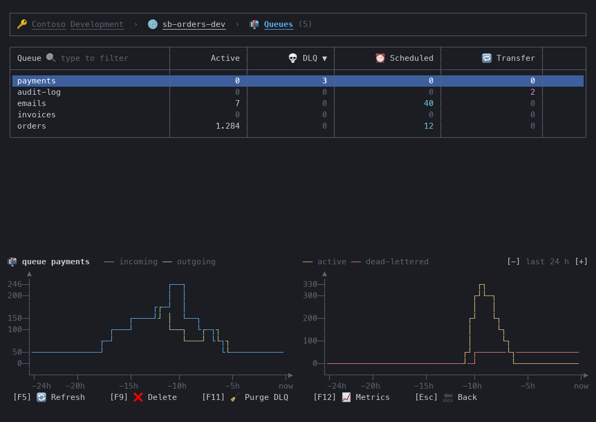

**Metrics over a week**: zoomed out to 7 days with `-`

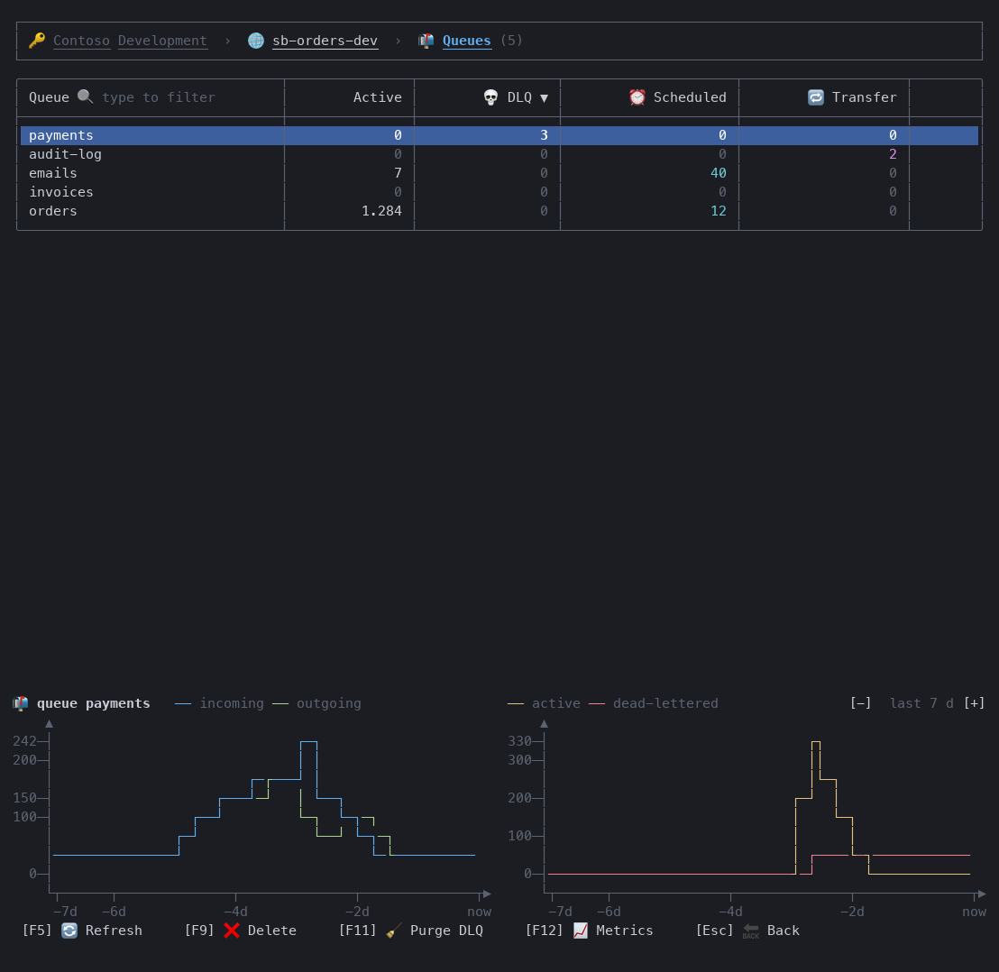

**Live counts**: lists poll every 15 seconds; a changed count flashes and fades


**Header dropdowns**: switch namespace (or subscription, or section) in place

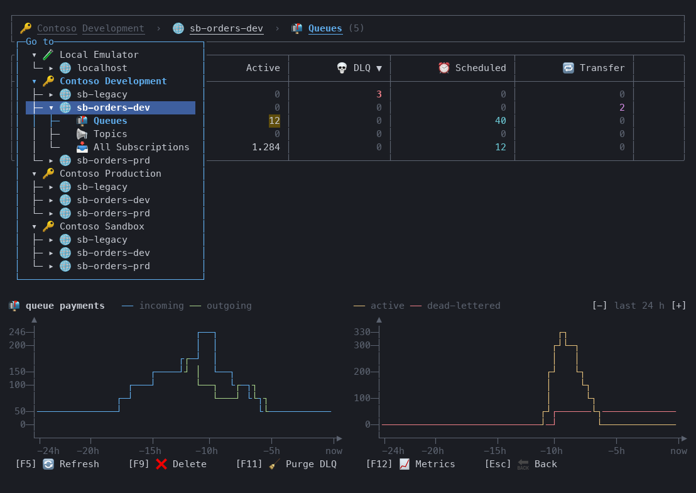

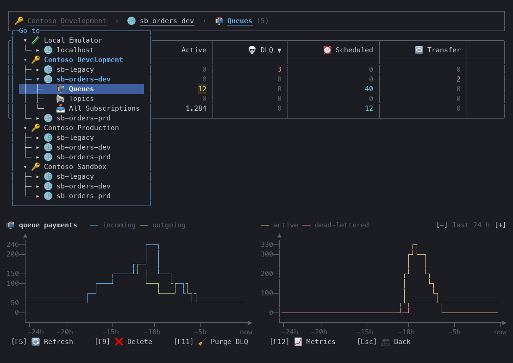

**Message browser**: dead-letter reasons, delivery counts, multi-select, preview of the message under the cursor

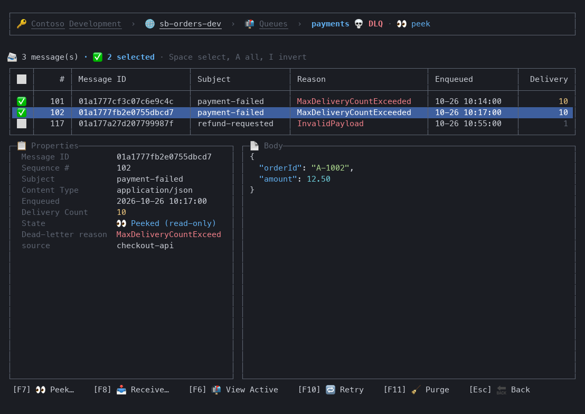

**Retry**: confirm the flow, follow its progress, check the result

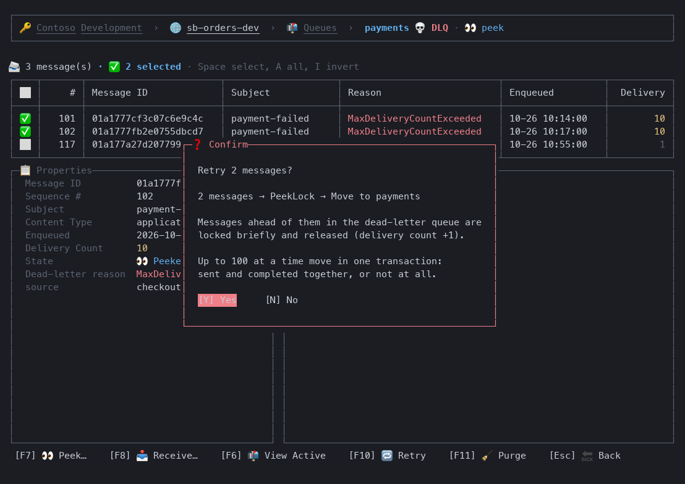

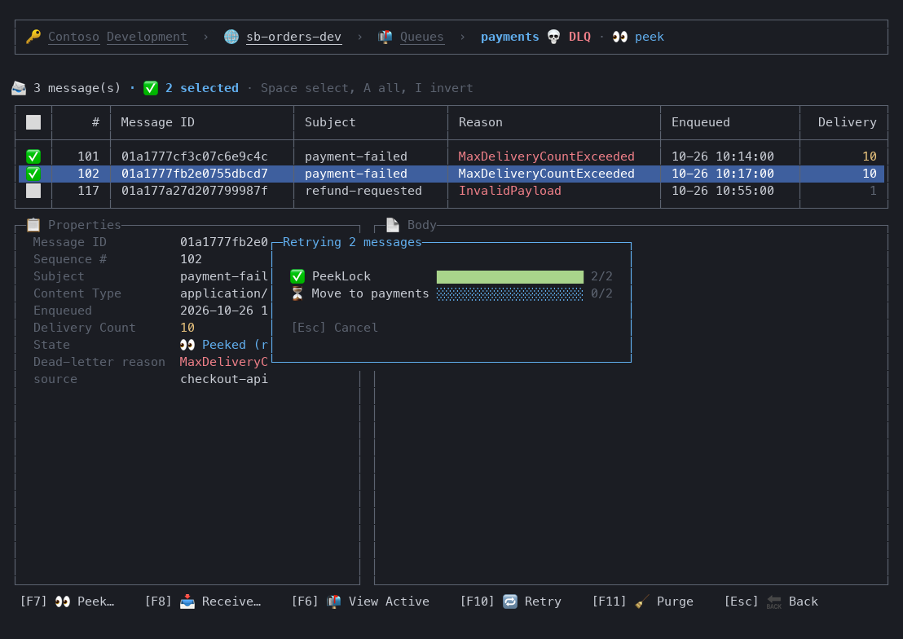

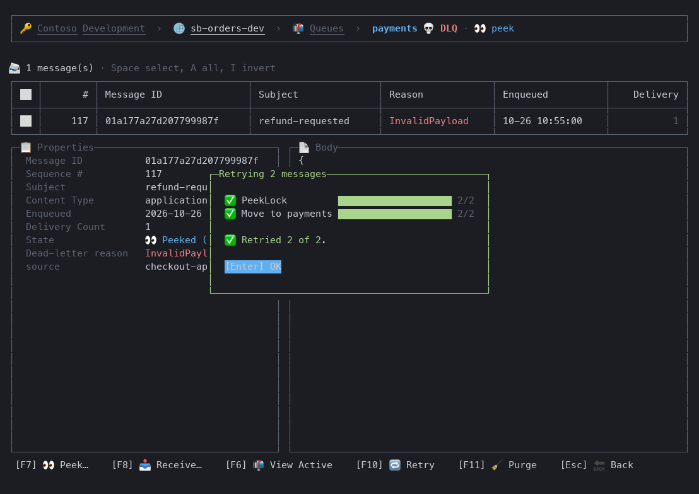

**Message detail**: properties and highlighted JSON body

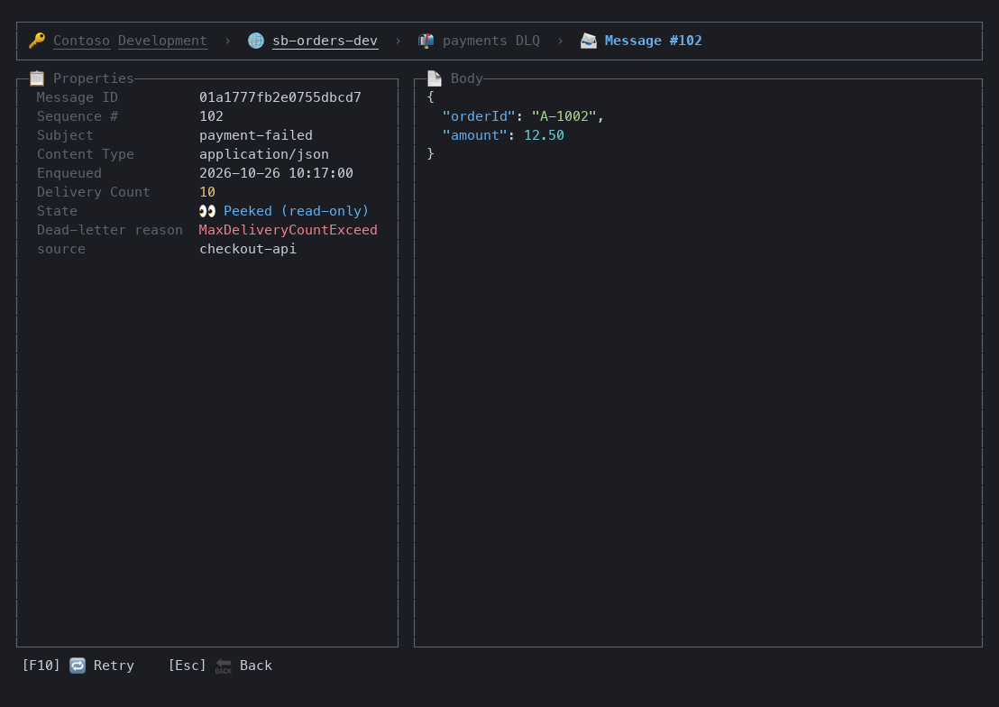

**All subscriptions** across every topic

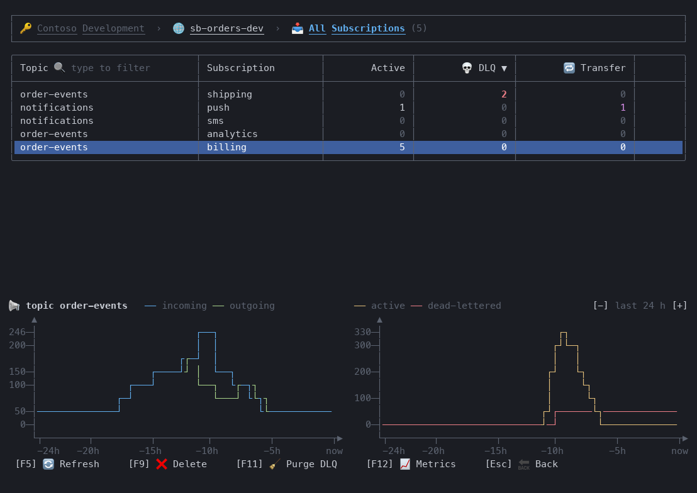

## Keyboard shortcuts

### All screens

| Key | Action |
|-----|--------|
| `Tab` / `Shift+Tab` | Move focus between controls |
| `Enter` / `Space` | Activate the focused button |
| `PgUp` / `PgDn` / `Home` / `End` | Page through the focused list |
| `Y` / `Enter`, `N` / `Esc` | Confirm or cancel a prompt |
| `Esc` | Go back to previous screen |
| Click | Activate a button, or select a row; click the selected row to open it |
| Click a column header | Sort by it: ascending, descending, off |
| Click subscription / namespace / section in the header | Open a dropdown to switch |
| Mouse wheel | Scroll the list under the pointer |

### Connection screen

| Key | Action |
|-----|--------|
| `↑` / `↓` | Choose a subscription or namespace |
| Type / `Backspace` | Filter Azure subscriptions by name or ID (in the subscription list) |
| `Enter` | Subscriptions: go to namespaces; namespaces: open queues |
| `F1` | Open the queue list |
| `F2` | Open the topic list *(not on Basic tier)* |
| `F3` | Open the all-subscriptions list *(not on Basic tier)* |

### Queue list / Topic list / Subscription list

| Key | Action |
|-----|--------|
| Type | Filter list by name |
| `Backspace` | Remove last filter character |
| `↑` / `↓` | Scroll list |
| `Enter` | Open selected item |
| `F5` | Refresh (also the metrics charts) |
| `F9` / `Del` | Delete focused item *(not on the local emulator)* |
| `F11` | Purge the focused queue's or subscription's dead-letter queue |

### Metrics panel

Connection screen and lists, Azure namespaces only.

| Key | Action |
|-----|--------|
| `F12` | Show or hide the panel |
| `+` or `=` | Zoom in: shorter time range |
| `-` or `_` | Zoom out: longer time range; only while the filter is empty, since names can contain `-` and `_` |
| `[-]` / `[+]` in the panel header | The same, by click or `Tab` |

### Queue browser / Subscription browser

| Key | Action |
|-----|--------|
| `F6` | Toggle between active queue and DLQ |
| `F7` | Peek… (count, optional start sequence number) |
| `F8` | Receive… (count, PeekLock or ReceiveAndDelete) |
| `Space` | Select / deselect message (or click its checkbox) |
| `A` / `I` | Select all / invert selection |
| `Esc` | Clear selection, then back |
| `F9` / `Del` | Complete *(locked)* |
| `F4` | Abandon *(locked)* |
| `F3` | Dead-letter *(locked, active queue)* |
| `F10` | **Retry** *(dead-letter queue)* / Requeue *(received-and-deleted)* / Resend copy *(peeked, active queue)* |
| `F11` | Purge |
| `↑` / `↓` | Move through message list |
| `Tab` | Move into the preview body (`↑` / `↓` scroll it; page keys keep working) |
| `Enter` | Open the message full screen |

Actions apply to the selected messages, or to the focused one when nothing is selected.

### Message detail

| Key | Action |
|-----|--------|
| `↑` / `↓` | Scroll message body |
| `F9` `F4` `F3` `F10` | Same actions as the browser, for this message |

## Prerequisites

- [.NET 10 SDK](https://dotnet.microsoft.com/download)
- [Azure CLI](https://learn.microsoft.com/en-us/cli/azure/install-azure-cli) logged in:

```bash
az login
```

Authentication uses `AzureCliCredential` — no connection strings or API keys are stored. The subscriptions you see are the ones your `az login` account can access.

- The metrics panel reads `Microsoft.Insights/metrics/read` on the namespace: Reader and Monitoring Reader include it, the Azure Service Bus Data roles don't. Without it the panel shows the error in one line
- A namespace firewall must allow your IP. When it doesn't, the app says so: connect through an allowed network (VPN), or add your IP under Networking for the namespace in the Azure portal

## Running from source

Requires the [.NET 11 SDK](https://dotnet.microsoft.com/download/dotnet/11.0) (`global.json`): RazorConsole also builds for `net11.0`.

```bash
git clone --recurse-submodules https://github.com/zidad/azure-servicebus-console
cd azure-servicebus-console
az login
dotnet run --project src/ServiceBusConsole
dotnet run --project src/ServiceBusConsole -- -s emulator   # command-line flags go after --
```

Logs are written to `logs/session-<timestamp>.log` next to the app's binaries (`src/ServiceBusConsole/bin/Debug/net10.0/logs/` when run from source).

### Local emulator

```bash
docker compose up -d
```

Starts the [Service Bus emulator](https://learn.microsoft.com/azure/service-bus-messaging/overview-emulator) on `localhost:5672` with the queues and topics of `emulator/Config.json`, and seeds them with sample messages. The emulator has no management API: the app reads its entities from `emulator/Config.json` in the current directory, so run it from the repository root, and counts come from peeking (up to 1,000 messages). Without a management API it can't delete entities either, so Delete is hidden there.

## How message operations work

The browser follows the Service Bus Explorer in the Azure portal:

- **Peek** is read-only.
- **Retry** (dead-letter queue): peek, select the messages to retry, press `F10`. The selected messages are locked, sent to the origin queue (or the topic, for subscriptions: every subscription gets a copy) in order, then removed from the dead-letter queue. Service Bus can only lock from the front of a queue, so dead-lettered messages ahead of them are locked briefly and released; their delivery count goes up by one and they stay in the dead-letter queue. Already locked or received messages are retried the same way, without the extra lock step. On Standard and Premium namespaces each chunk of up to 100 messages moves in one transaction: the copies are sent and the originals completed together, or not at all, so a failure (or `Esc`) leaves the chunk in the dead-letter queue instead of duplicating it. Basic tier namespaces and the local emulator have no transactions: there a failure between sending and completing can leave a copy in the queue while the original stays dead-lettered.
- **Receive (PeekLock)** locks the messages on a receiver that stays open. Locks are renewed in the background and abandoned when you leave the page or load something else, so messages come back right away instead of after lock expiry.
- **Receive (ReceiveAndDelete)** removes messages immediately; requeue them before leaving or they are gone.
- **Resend** (active queue, peeked) sends copies; the originals stay.

Bulk actions show a progress dialog (`Esc` cancels). When done it shows the result, including any failures, until you press `Enter` (OK); failed messages stay selected so you can retry. If nothing is left in the list, OK returns to the queue or subscription list.

## Metrics

The metrics panel charts the current namespace's Azure Monitor metrics: incoming and outgoing messages per interval on the left, the active and dead-lettered backlog on the right.

- **Lists** (Queues, Topics, Subscriptions, All subscriptions): at the bottom, for the selected queue or topic. A subscription shows its topic's metrics: Azure Monitor has no per-subscription dimension
- **Connection page**: at the bottom of the screen, below the subscription and namespace lists, for the selected namespace, in a fixed-height area so nothing moves when the selection changes. It needs room for the logo, every subscription row and three namespace rows (about 42 lines and up)
- **Time range**: `[-] last 24 h [+]` in the panel header steps through 1 h, 3 h, 6 h, 12 h, 1 d, 3 d, 7 d, 14 d and 30 d (default 1 d) and is remembered. The interval (1 minute to 1 day) follows the range and the chart width; the time axis is in minutes, hours or days
- Cached charts show first, then the live ones; `F5` on a list reloads them
- Shown by default on terminals of 35+ lines; `F12` shows or hides it, remembered across runs. Always hidden on terminals too short for it
- Azure namespaces only: the local emulator has no Azure Monitor metrics, so its lists have no panel and the connection page shows a one-line note in its place

## Releasing

Push a version tag on a commit on `main`:

```bash
git tag v1.2.3 origin/main
git push origin v1.2.3
```

The [publish workflow](.github/workflows/publish.yml) runs the tests, packs the tool with the tag's version, pushes it to NuGet.org and creates a GitHub release with generated notes and the package attached. There is no version number in the code.

Publishing uses [NuGet trusted publishing](https://learn.microsoft.com/nuget/nuget-org/trusted-publishing) — no API key secret is stored. The workflow exchanges a GitHub OIDC token for a short-lived nuget.org API key via `NuGet/login`.

This requires a trusted publishing policy on nuget.org (Account → Trusted Publishing) with:

| Field | Value |
| --- | --- |
| Repository Owner | `zidad` |
| Repository | `azure-servicebus-console` |
| Workflow File | `publish.yml` |
| Environment | *(leave empty)* |

## Built with

- [Azure.Messaging.ServiceBus](https://www.nuget.org/packages/Azure.Messaging.ServiceBus) — Service Bus client
- [Azure.ResourceManager.ServiceBus](https://www.nuget.org/packages/Azure.ResourceManager.ServiceBus) — namespace discovery via ARM
- [Azure.ResourceManager.Monitor](https://www.nuget.org/packages/Azure.ResourceManager.Monitor) — Azure Monitor metrics
- [JasperFx](https://www.nuget.org/packages/JasperFx) — command line
