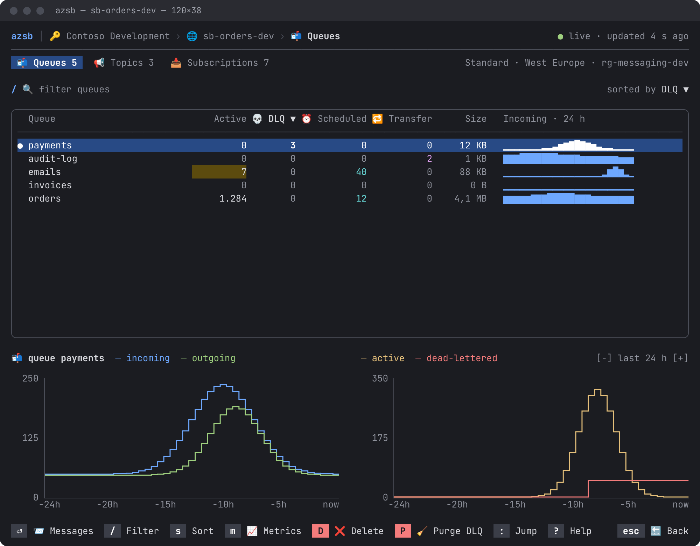
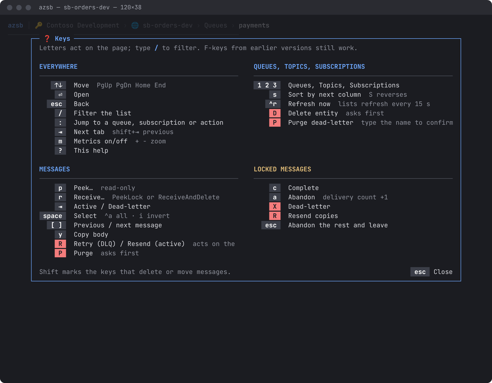
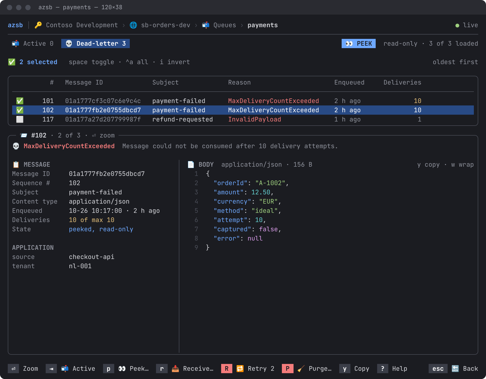
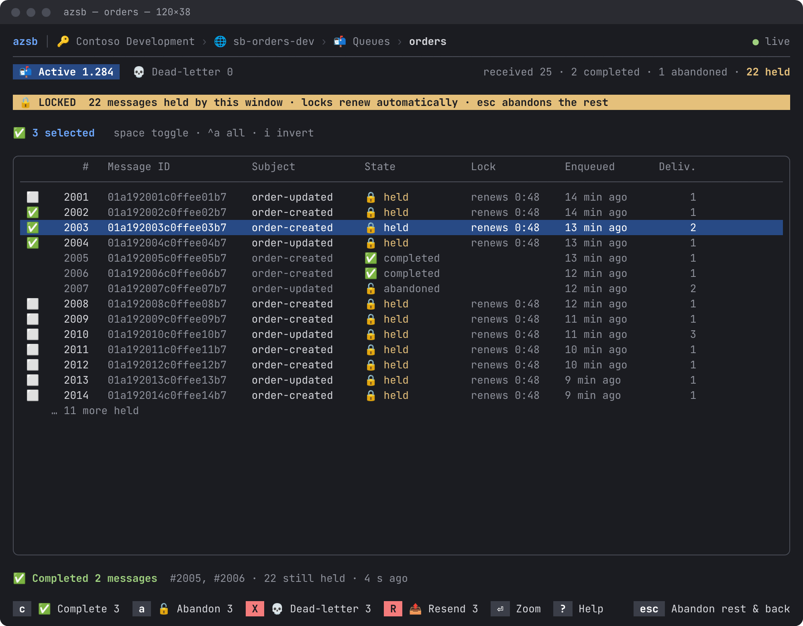
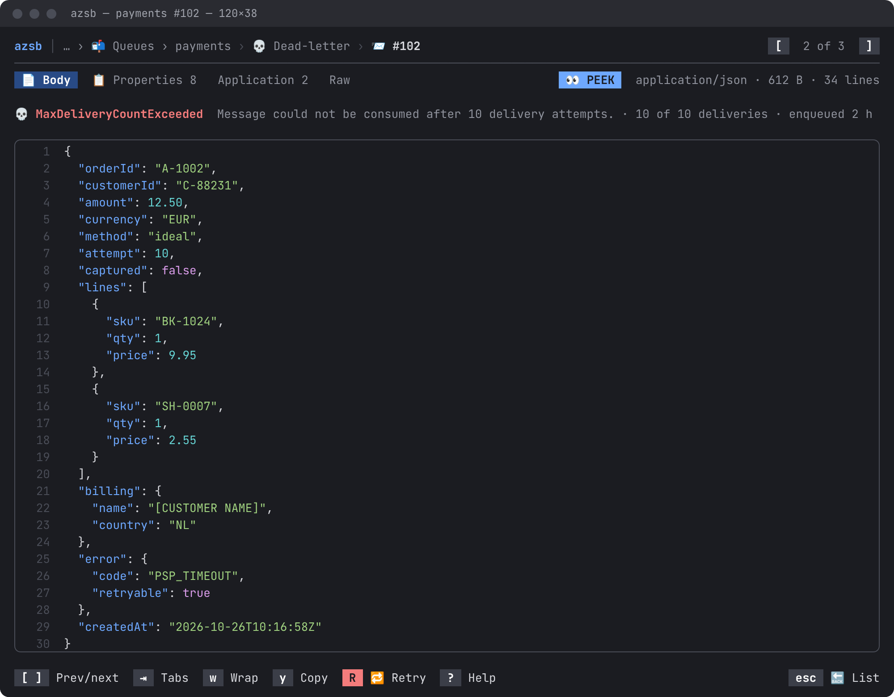
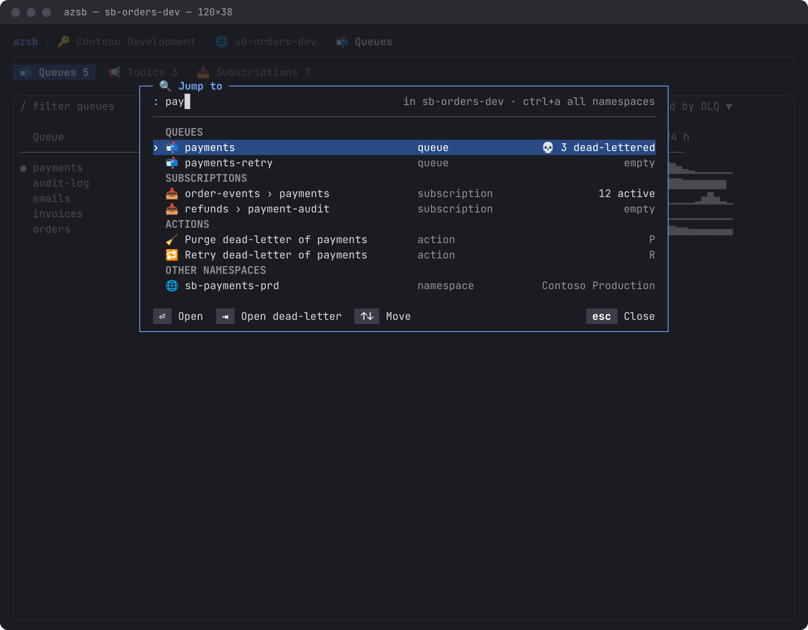
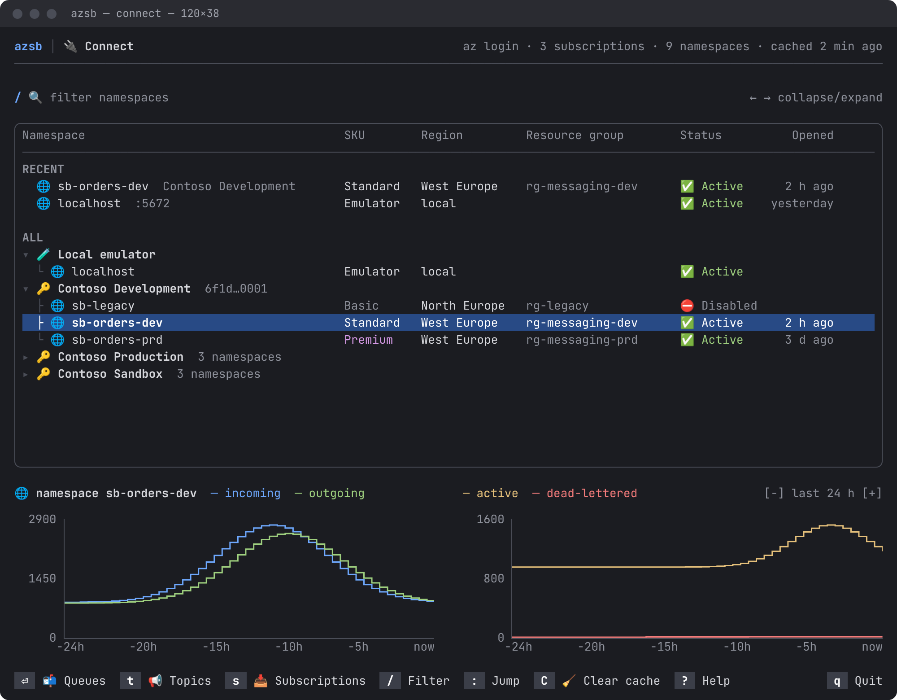
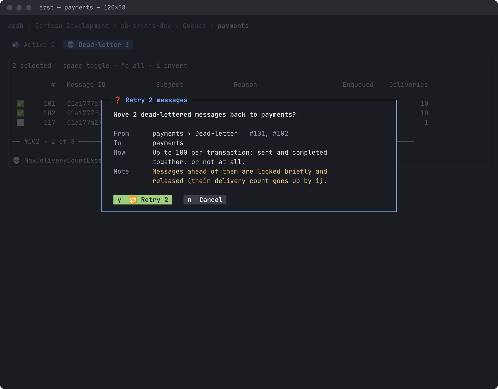

# UI redesign plan

Mockups: https://claude.ai/artifact/UjxeBgmjH6dHtSwYCV3cuT, rendered to `screens/` (dark; `queues-light.png` shows the light palette).
Each phase is one issue and one PR. Follow `CLAUDE.md` for style, tests and the fork rules, and update the screenshots (`tools/update-screenshots.sh`) in every PR that changes a page.

Decided:

- Keep the emoji (breadcrumbs, tabs, column headers, tree, buttons, ✅/⬜ selection).
- One subtle rounded border around the main content (the table, the message preview); no boxed header, no column lines inside.
- Keep the metrics panel as it is; only its surrounding borders go.
- Count columns keep their short headers (`💀 DLQ`), sized for small numbers.
- Letter keys with Shift for anything that deletes or moves messages; F-keys stay as aliases. `/` opens the filter.
- Opening a message in an editor is #104 (plugin), not part of this.

## Phase 1: header and tables

- `ConnectionHeader.razor`: drop the `Panel`; one line `azsb │ 🔑 subscription › 🌐 namespace › 📬 Queues`, right-aligned status (`● live · updated 4 s ago`, `◐ cached` while `IsRefreshing`), then a `─` rule. `FullscreenLayout.Header` 3 → 2.
- List tables (`QueueListPage`, `TopicListPage`, `SubscriptionListPage`, `AllSubscriptionsPage`, `MessageBrowserView`): one rounded border (`Theme.Border`) around the table, filling the space above the metrics; inside it no column lines, a rule under the header, no empty spacer rows, no empty trailing column. The message preview gets the same border with `📨 #102 · 2 of 3` in it. Start with `TableBorder.None` plus a rule; if `SelectableList`/`NavigableTBody` need a border RazorConsole lacks, add the smallest hook to the fork (`azsb`) with an upstream PR. Update the `*TableChrome` constants.
- A `●` (danger) gutter on rows with dead letters.
- `MetricsPanel`: same charts, legend and zoom; no border around it.
- `Palette.cs`: add `Chip`/`OnChip` for key chips (dark: `Grey`/`White`, light: `Silver`/`Black`), `Badge`/`OnBadge`, `LockedStrip`, `DeletedStrip`. Only the 16 palette colors.
- Relative times in lists (`2 h ago`), absolute in the preview.

Tests: screenshots change; existing UI tests pass unchanged.

## Phase 2: keys, `/` filter, help

- `UI/KeyMap.cs`: `sealed record KeyBinding(string Key, string? Alias, string Label, bool Danger, Func<bool> Available, Action Run)`. A page declares its bindings once; footer, help and `HandleKeyDown` read them. Today each key is written in the footer and in a `switch`; help would make it three.
- `Components/KeyHints.razor`: chips (`D ❌ Delete`; red chip for danger), clickable like `KeyButton`.
- Keys:
  - everywhere: `/` filter, `:` jump, `?` help, `⇥` next tab, `m` metrics (`+ -` zoom), `esc` back, `q` quit on the connection page
  - lists: `⏎` open, `s`/`S` sort, `^r` refresh, `D` delete, `P` purge DLQ, `1 2 3` sections
  - messages: `p` peek, `r` receive, `space` select, `^a` all, `i` invert, `R` retry/resend, `P` purge, `[ ]` previous/next, `y` copy
  - locked: `c` complete, `a` abandon, `X` dead-letter, `R` resend, `esc` abandon the rest and leave
  - every current F-key keeps working
- `ColumnFilter`/`FilterEdit`: `/` opens, `esc` clears and closes, `⏎` keeps. The `-`/`_` metrics exception goes away.
- `Components/HelpDialog.razor` on `?`, built from the page's bindings plus the global ones.

Tests: filter tests send `/` first; per page, each binding runs the same action as its F-key alias.

## Phase 3: namespace tabs

- Replace the section dropdown (`SectionCrumb`, `UI/Section.cs`) with a tab row `📬 Queues 5  📢 Topics 3  📥 Subscriptions 7` (`1 2 3`, `⇥`). Routes stay; a tab navigates. Hide topics and subscriptions without `IHasTopics`.
- Counts from the cached listings, so the row renders at once. Right side: `Standard · West Europe · rg-messaging-dev`.

## Phase 4: incoming · 24 h column

- A sparkline column (`▁▂▃▄▅▆▇█`, 24 points) on the queue, topic and subscription lists.
- One Azure Monitor request per namespace, `IncomingMessages` split by `EntityName`, hourly grain; not one per entity. Add it to `IMetricsService` as one call returning a series per entity.
- Polled every 5 min (not with the 15 s counts), cached in the file cache like the other metrics. No column without `IHasMetrics` (emulator) or on narrow terminals.
- Subscriptions show their topic's series (no per-subscription dimension), like the metrics panel.

Tests: a fake metrics service with known series; the column renders the expected blocks; the request count stays at one per poll.

## Phase 5: message browser

- `MessageBrowserView.razor`: `📬 Active` / `💀 Dead-letter` tabs (`⇥`) with counts, replacing F6. Badge `👀 PEEK` on the right. In `BrowseMode.Locked` a full-width strip `🔒 LOCKED · 22 held · locks renew automatically · esc abandons the rest`; after ReceiveAndDelete a red strip (`receive-and-delete.png`) until requeued.
- Locked lists keep completed and abandoned rows, dimmed, with a State column (`🔒 held`, `✅ completed`, `🔓 abandoned`) and a Lock column.
- Complete, abandon and dead-letter in Locked mode report in a one-line status (`✅ Completed 2 messages · 22 still held`). Retry, Resend, Requeue and Purge keep `OperationDialog`. Update the CLAUDE.md rule "batch operations end in OperationDialog".
- `MessagePreview.razor`: dead-letter line first (`💀 reason  description`), then properties (44 columns, grouped `📋 MESSAGE` / `APPLICATION`) beside the body with line numbers and a `content-type · size` header.
- Add `DeadLetterErrorDescription` to `MessageInfo`; map it in `ServiceBusMessageInfo` and the emulator, keep it out of `Properties` like the reason, include it in `MessageMarkdown`/`MessageJson`.
- Footer labels carry the count they act on: `🔁 Retry 2`, `✅ Complete 3`.

## Phase 6: message zoom

- `MessageDetailPage.razor` becomes a full-height view: tabs `📄 Body / 📋 Properties / Application / Raw` (`⇥`), `w` wrap, `[ ]` previous/next through the `MessageBrowser` list the store already shares, `y` copies the body with OSC 52 (works over SSH).

## Phase 7: jump palette

- `Components/JumpDialog.razor` on `:`: matches the current namespace's cached queues, topics and subscriptions, actions on the match (open dead-letter, purge, retry) and other namespaces; `^a` searches all namespaces. `⏎` opens, `⇥` opens the dead-letter queue. Grouped by kind, dead-letter counts shown.
- Matching is a pure `JumpIndex.Search(string query, IEnumerable<JumpTarget>)` with unit tests; the dialog only renders it.

## Phase 8: connection page and dialogs

- `ConnectionPage.razor`: remove the Figlet banner (6 lines).
- `ConnectionTree.razor`: columns Namespace, SKU, Region, Resource group, Status, Opened instead of a `·`-joined string; a RECENT group on top (last 5 opened, in the file cache); collapsed subscriptions show `3 namespaces`. Keys `⏎` queues, `t` topics, `s` subscriptions.
- One `Components/Dialog.razor` frame for `ConfirmModal`, `FetchDialog`, `OperationDialog` and `ErrorModal`: title in the border, a label grid (From / To / How / Note), a primary and a plain button. Progress and result stay in the same frame (`retry-progress.png`, `retry-result.png`). Purge asks for the entity name.

## Order

1 and 2 first (most of the visible change, and the rest builds on them), then 3–8 in any order.
